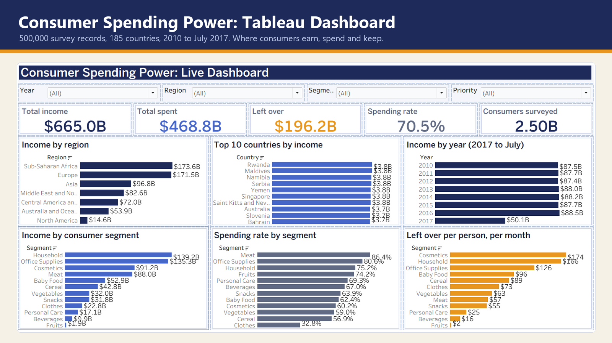
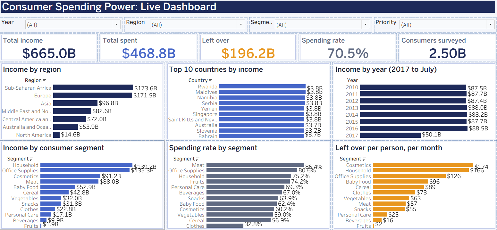
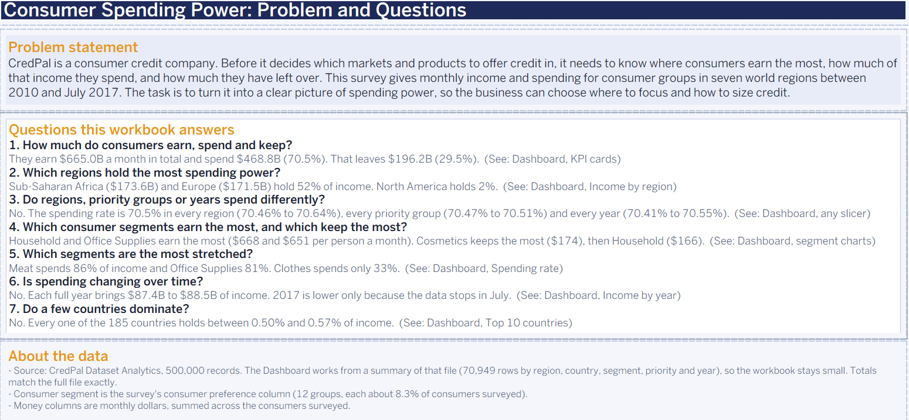
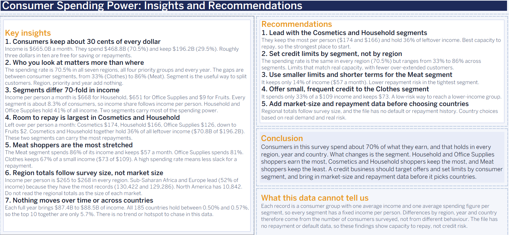

# Tableau Project: Consumer Spending Power Dashboard

**Where do consumers earn the most, how much of it do they spend, and who has room left to repay a loan?**

A Tableau dashboard on a survey of 500,000 consumer records from 185 countries (2010 to July 2017). It answers seven business questions for a consumer credit company and ends with insights, recommendations and a conclusion.



## Quick links

- 📊 [Tableau workbook](tableau/CredPal%20Consumer%20Spending.twbx), with three pages: Brief, Dashboard and Insights
- 🗂️ [Summary data (CSV)](data/credpal_spending_summary.csv)
- 🖼️ [Brief page](docs/brief.png) and [Insights page](docs/insights.png)

---

## Table of Contents

- [Problem statement](#problem-statement)
- [Questions and answers](#questions-and-answers)
- [The dashboard](#the-dashboard)
- [Key insights](#key-insights)
- [Recommendations](#recommendations)
- [Conclusion](#conclusion)
- [The data](#the-data)
- [Open it yourself](#open-it-yourself)
- [What changed from the first version](#what-changed-from-the-first-version)
- [Limitations](#limitations)
- [Repository structure](#repository-structure)
- [License](#license)

---

## Problem statement

CredPal is a consumer credit company. Before it decides which markets and products to offer credit in, it needs to know where consumers earn the most, how much of that income they spend, and how much they have left over. The survey gives monthly income and spending for consumer groups in seven world regions between 2010 and July 2017. The task is to turn it into a clear picture of spending power, so the business can choose where to focus and how to size credit.

---

## Questions and answers

| # | Question | Answer |
|---|---|---|
| 1 | How much do consumers earn, spend and keep? | They earn $665.0B a month in total and spend $468.8B (70.5%). That leaves $196.2B (29.5%). |
| 2 | Which regions hold the most spending power? | Sub-Saharan Africa ($173.6B) and Europe ($171.5B) hold 52% of income. North America holds 2%. |
| 3 | Do regions, priority groups or years spend differently? | No. The spending rate is 70.5% in every region (70.46% to 70.64%), every priority group (70.47% to 70.51%) and every year (70.41% to 70.55%). |
| 4 | Which consumer segments earn the most, and which keep the most? | Household and Office Supplies earn the most ($668 and $651 per person a month). Cosmetics keeps the most ($174), then Household ($166). |
| 5 | Which segments are the most stretched? | Meat spends 86% of income and Office Supplies 81%. Clothes spends only 33%. |
| 6 | Is spending changing over time? | No. Each full year brings $87.4B to $88.5B of income. 2017 is lower only because the data stops in July. |
| 7 | Do a few countries dominate? | No. Every one of the 185 countries holds between 0.50% and 0.57% of income. |

---

## The dashboard

The Dashboard page has a navy sidebar with four filters (Year, Region, Segment, Priority) and a short reading guide, five KPI cards, and six charts, including a treemap of income by segment shaded by spending rate. Every filter applies to every card and chart.



| KPI | Value |
|---|---|
| Total income, per month | $665.0B |
| Total spent | $468.8B |
| Left over | $196.2B |
| Spending rate | 70.5% |
| Consumers surveyed | 2.50B |

The Brief page holds the problem statement and questions. The Insights page holds the findings below.



---

## Key insights

1. **Consumers keep about 30 cents of every dollar.** Income is $665.0B a month. They spend $468.8B (70.5%) and keep $196.2B (29.5%).
2. **Who you look at matters more than where.** The spending rate is 70.5% in all seven regions, all four priority groups and every year. The gaps are between consumer segments, from 33% (Clothes) to 86% (Meat).
3. **Segments differ 70-fold in income.** Income per person a month is $668 for Household, $651 for Office Supplies and $9 for Fruits. Household and Office Supplies hold 41% of all income.
4. **Room to repay is largest in Cosmetics and Household.** Left over per person a month is $174 and $166. Together they hold 36% of all leftover income ($70.8B of $196.2B).
5. **Meat shoppers are the most stretched.** The Meat segment spends 86% of its income and keeps $57 a month.
6. **Region totals follow survey size, not market size.** Income per person is $265 to $268 in every region. Sub-Saharan Africa and Europe lead because they have the most records (130,422 and 129,286). North America has 10,842.
7. **Nothing moves over time or across countries.** Each full year brings $87.4B to $88.5B of income. The top 10 countries together are only 5.7%.



---

## Recommendations

| Priority | Action | Why |
|---|---|---|
| High | Lead with the Cosmetics and Household segments | They keep the most per person ($174 and $166) and hold 36% of leftover income. |
| High | Set credit limits by segment, not by region | The spending rate is the same in every region (70.5%) but ranges from 33% to 86% across segments. |
| Medium | Use smaller limits and shorter terms for the Meat segment | It keeps only 14% of income ($57 a month). |
| Medium | Offer small, frequent credit to the Clothes segment | It spends only 33% of a $109 income and keeps $73. |
| Medium | Add market-size and repayment data before choosing countries | Regional totals follow survey size, and the file has no default or repayment history. |

---

## Conclusion

Consumers in this survey spend about 70% of what they earn, and that holds in every region, year and country. What changes is the segment. Household and Office Supplies shoppers earn the most, Cosmetics and Household shoppers keep the most, and Meat shoppers keep the least. A credit business should target offers and set limits by consumer segment, and bring in market-size and repayment data before it picks countries.

---

## The data

The source is a survey file of 500,000 records. Each record is a group of consumers with a region, country, consumer preference (called segment here), priority code, study dates, number of samples, average monthly income and average monthly spending.

The workbook uses a summary of that file: 70,949 rows by region, country, segment, priority and year, with income, spending and disposable income added up. Totals match the full file exactly (income $665,048,154,990.80).

| Column | Description |
|---|---|
| `Region`, `Country` | 7 regions and 185 countries |
| `Segment` | The consumer preference column: 12 groups, each about 8.3% of consumers surveyed |
| `Priority` | Priority code (C, H, L or M), evenly split |
| `Year` | Year the study started, 2010 to 2017 |
| `Records`, `Samples` | Number of survey records and consumers surveyed |
| `Income`, `Expenditure`, `Disposable` | Monthly dollars, added up across the consumers surveyed |

I checked the arithmetic on every one of the 500,000 records: income always equals samples times average income, and disposable income always equals income minus spending. The source labels two columns "(00 $)", but all three money columns reconcile in whole dollars, so they are shown that way.

---

## Open it yourself

1. Install [Tableau Public](https://public.tableau.com/app/discover) (free) or use Tableau Desktop.
2. Open `tableau/CredPal Consumer Spending.twbx`. The data is packaged inside it.
3. Use the tabs at the bottom: Brief, Dashboard and Insights.

---

## What changed from the first version

This began as a group dashboard on the same data. In this rework I rebuilt it around a clear question and fixed what I found:

| Issue in the first version | Fix |
|---|---|
| A chart titled "Total Income vs consumer preference" showed 3,344,644 for Household. That is the average income per record, not the total ($139.2B). | Charts now show true totals and say what they measure. |
| A calculated field called Savings Rate used `income - expenditure / income`, which divides before it subtracts. | Replaced with a spending rate, expenditure divided by income, and a left over per person measure. |
| One page listed the group members. | Removed. |

---

## Limitations

- **Each record is a consumer group with one average income and one average spending figure per segment**, so every segment has a fixed income per person. Differences by region, year and country come from the number of consumers surveyed, not from different behaviour.
- **There is no repayment or default data**, so the findings show capacity to repay, not credit risk.
- **2017 is a partial year**, ending in July.

---

## Repository structure

```
credpal-consumer-spending-tableau/
├── README.md
├── LICENSE
├── CONTRIBUTING.md
├── tableau/
│   └── CredPal Consumer Spending.twbx
├── data/
│   └── credpal_spending_summary.csv
└── docs/
    ├── cover.png
    ├── dashboard.png
    ├── brief.png
    └── insights.png
```

---

## License

Released under the MIT License. See [LICENSE](LICENSE).

---

**Built by Bih Brandy Sango** · Data Scientist and BI Analyst
